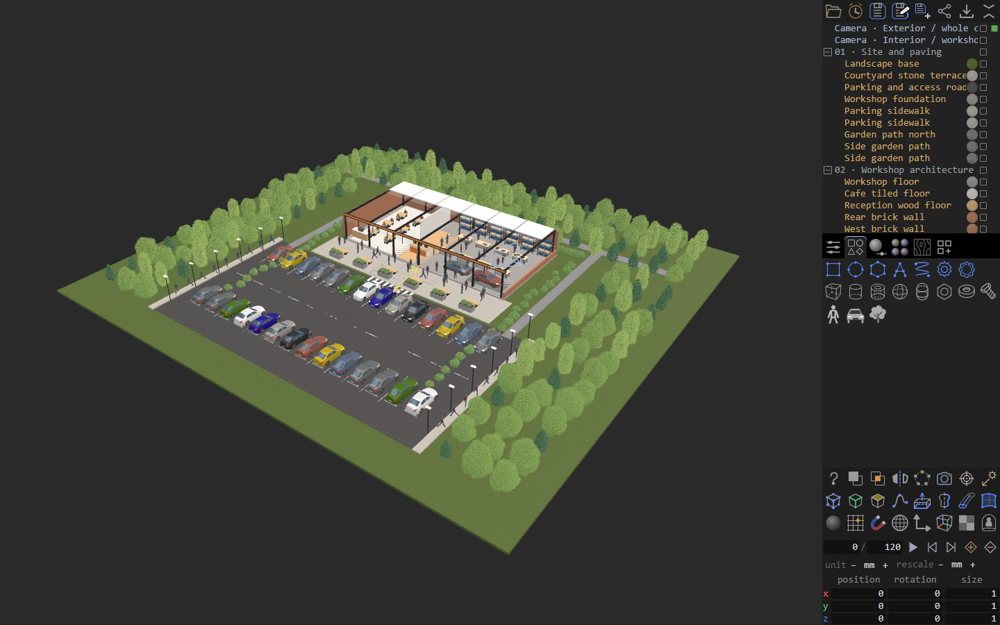

# Frame

A browser-based 3D workspace for spline and polygon modeling, scene assembly, and print-layer inspection.

**[Open Frame](https://mozg4d.github.io/frame/)** · [Task queue](https://mozg4d.github.io/frame/queue.html)

## Current application

The hosted application is **r244**. It provides parametric primitives, surface generators, Boolean operations, shared instances, materials, and animation. Native `.hash` files preserve editable scenes; geometry exchange supports glTF/GLB, OBJ, STL, PLY, SVG, and DXF.

The viewport requires a supported WebGPU configuration. Startup checks capabilities and offers Retry if initialization fails. Mip generation is selected through fresh numerical checks for each GPU generation, including odd-sized textures. Calibration failures expose a copyable diagnostic report. r229 reuses resources within one owner-bound calibration session while retaining the same validation controls. Startup timing still needs measurement on each target device. Cached application resources can be reopened offline through the PWA.

The slicer generates perimeter paths with guarded adaptive handling and Solid or Lines–Dots layer previews. Broader adaptive coverage and the practical print workflow remain unfinished. r230 accelerates exact Connected selection, refreshes coordinate-manager fields after Auto Local, and uses plain left-button camera navigation in 3D while retaining 2D marquee. r231 preserves natural double-click selection by waiting for 6 pixels of component drag before capturing geometry; small perspective left-button jitter no longer orbits the camera. Gizmo dimensions are unchanged. r232 adds GPU preview for eligible whole-island World Move/Rotate, with exact CPU authoring commits and sparse Undo/Redo. New logical contacts or changes to quantized vertex groups invalidate reuse. Local/Scale and other unsupported paths keep their existing CPU costs; selection revalidation can still make release slow. Native .hash loading preserves saved normals and indices. r233 also accelerates eligible whole-island Move in the default Object coordinate mode. Exact shared-edge connectivity allows safe reuse across internal quantization changes; near-only or unused aliases retain conservative validation. Object Rotate, Scale and nonuniform-owner cases retain their prior CPU behavior. r234 keeps plain wire aligned with GPU component preview, invalidates position-dependent topology caches after sparse edits, and gives marquee and taps the same latched 6-pixel threshold. Navigation checks for a complete verified update with a bounded cached fallback; existing scenes are never automatically reloaded and old caches are retained. Large rectangle selection still has significant latency and is not accepted as a fast workflow. r235 moves derived component selection buffers and measurements into cancellable cooperative work, allowing subsequent gestures while they finish. Undo/Redo restores the immediate gizmo and highlight pose before that work runs. Authoring commits and tight bounds still contain synchronous release work. r236 adds guarded affine island processing for eligible World/Object Move, Rotate and Scale, including full stock canonical fallback where needed for exact coordinates, crease normals and topology. Unsupported contexts keep their CPU path. Preparation and publication costs remain workload-dependent. r238 reduces STL import coordinate-classification and edge-lookup work while retaining both ordered stock crease passes and exact geometry, picking and wire results. r239 runs independent STL BVH and wire preparation in separate budgeted workers when eligible, with a shared 64 MiB index-copy reservation and serial fallback. Geometry and both crease passes remain unchanged. r240 reports slicer stages, committed/source-active model-layer counts, status-message age and last-completed-layer age. Explicit transport errors settle the task and release its workers, ports and queued shared-budget requests. This does not establish slicing speed or geometry quality; no production timeout is added.

r241 reuses one bounded exact edge table and prepares edge-selection/coordinate-manager measurements cooperatively, with stale source and interaction checks before publication and click continuation. Raw aliases, pivot and history semantics are preserved. Partial-face and very large selections remain expensive; this is not a general selection-latency or frame-rate guarantee.

r242 reuses immutable slicer descriptions and bounded original-topology operands, and avoids repeated edge-array construction inside a cleanup scan. Geometry, provenance, native task protocol and the shared worker budget retain their prior behavior. Source controls and three-layer synthetic browser lifecycle checks passed; these checks do not establish production slicing speed, broader adaptive coverage or physical-print acceptance. The r241 editor/native component behavior is unchanged.

r243 fixes Escape/pointer cancellation and retired release ownership, preserves stock selection ordering, reduces repeated numeric Move selection/connectivity work with bounded exact caches, and makes Recent reopen stored handles with explicit permission/unavailable-file behavior. Source/regression checks pass. Representative browser checks are recorded separately from full acceptance: heavy original-STL testing is blocked by a re-requested browser file permission, dense runtime performance is unmeasured, and independent heavy stock P/N/I equivalence remains unverified. Recent already-running load cancellation and simultaneous metadata-storage/deletion failure remain limitations. This release does not claim a complete performance or workflow fix. Private fixtures, recovery scenes, diagnostics and transient review artifacts are excluded.

r244 carries a verified complete Vertex component certificate onto the exact final Stock geometry after numeric Move and starts mapped preparation after selection installation. It rechecks final indices, ordered selection, complete membership, connectivity and owner/job stamps; declined contexts retain fallback. This avoids repeated corner expansion and global selection restoration in eligible repeated operations. One same-input HOME browser pair preserved exact Stock P/N/I and selection ordering, with lower second-operation time; this is not a general speed or immediate-repeat guarantee. Previous-publication queue wait, full connectivity/wire work and the inherited artificial-retirement cleanup gap remain. Native worker arithmetic and slicer behavior are unchanged.

## Repository

- `index.html`, `modules/`, `frame-sw.js`, and `manifest.webmanifest`: the current application and PWA.
- `models/` and `textures/`: application assets.
- [editor-source/](editor-source/): current rigid/affine editor source, pinned rebuild and portable checks.
- [slicer-source/](slicer-source/): current slicer progress and transport integration, exact rebuild and portable checks.
- [native-source/](native-source/): editable native viewport sources and their deterministic bundler.
- [development/gpu-v10/](development/gpu-v10/): unfinished GPU authoring work and reconstruction instructions.
- [development/slicer-lab/](development/slicer-lab/): unfinished slicer work and its development tools.
- [docs/NUMERIC_PRECISION.md](docs/NUMERIC_PRECISION.md): numeric storage and geometry rules.
- [queue.html](queue.html): open work and future ideas.
- [licenses/](licenses/): project and third-party licenses.

Development sources are separate from the current application's loaded modules. See each development directory's README for its status and checks.

## License

Frame's original code and project materials are proprietary. © 2026 FRAME copyright holders. All rights reserved; see [licenses/FRAME.txt](licenses/FRAME.txt). The official hosted application is free to use. Third-party components retain their own licenses. For embedding or integration, contact [mozg4d@gmail.com](mailto:mozg4d@gmail.com).
